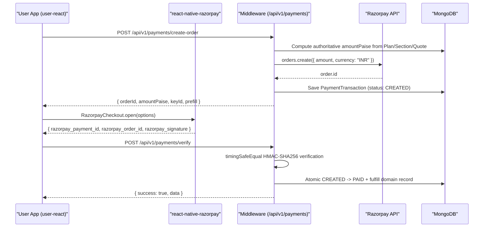

<!-- covers: middleware/src/services/razorpay.service.js, middleware/src/routes/payment.routes.js, middleware/src/controllers/payment.controller.js, middleware/src/models/paymentTransaction.model.js, middleware/src/config/env.js, middleware/src/routes/admin.routes.js, middleware/src/routes/index.js, mobile-application/user-react/src/services/paymentService.js -->

# Razorpay Payment, Refund & Route Settlement Architecture

This document describes GYMEZY's Razorpay payment gateway architecture across the Express middleware API, the User Mobile App (`mobile-application/user-react`), and Super Admin settlement governance.

## Key Components

| Component | Path | Responsibility |
|---|---|---|
| Environment Config | [`middleware/src/config/env.js`](../middleware/src/config/env.js) | Loads `RAZORPAY_KEY_ID`, `RAZORPAY_KEY_SECRET`, `RAZORPAY_WEBHOOK_SECRET`, and `PLATFORM_COMMISSION_PERCENT` |
| Razorpay Service | [`middleware/src/services/razorpay.service.js`](../middleware/src/services/razorpay.service.js) | SDK client singleton, order creation, timing-safe HMAC checkout/webhook verification, automated refunds, Route linked accounts & transfers |
| Payment Ledger Model | [`middleware/src/models/paymentTransaction.model.js`](../middleware/src/models/paymentTransaction.model.js) | Tracks `orderId`, `paymentId`, `flowType`, `amountPaise`, `status`, `refunds[]`, `routeTransfer`, and `draftPayload` |
| Payment Controller & Routes | [`middleware/src/controllers/payment.controller.js`](../middleware/src/controllers/payment.controller.js), [`middleware/src/routes/payment.routes.js`](../middleware/src/routes/payment.routes.js) | Mounted at `/api/v1/payments` via [`middleware/src/routes/index.js`](../middleware/src/routes/index.js) |
| Webhook Raw Body Parser | [`middleware/src/app.js`](../middleware/src/app.js) | Mounts `express.raw({ type: 'application/json' })` on `/api/v1/payments/webhook` before `express.json()` |
| User App Checkout Service | [`mobile-application/user-react/src/services/paymentService.js`](../mobile-application/user-react/src/services/paymentService.js) | Native `react-native-razorpay` checkout orchestration (`create-order` -> SDK open -> `verify`) |
| Super Admin Route Governance | [`middleware/src/controllers/admin.controller.js`](../middleware/src/controllers/admin.controller.js), [`middleware/src/routes/admin.routes.js`](../middleware/src/routes/admin.routes.js) | Linked account creation and settlement-gated Route transfers |

## Payment & Verification Lifecycle

## API Endpoints

### Public / Authenticated Payment Endpoints (`/api/v1/payments`)
- `POST /api/v1/payments/create-order`: Computes server-authoritative `amountPaise` for `MEMBERSHIP_PURCHASE`, `MEMBERSHIP_EXTEND`, `PLAN_SWITCH_UPGRADE`, `BOOKING_PASS`, or `WALLET_TOPUP` (applying gym wallet balance if requested) and creates a Razorpay order.
- `POST /api/v1/payments/verify`: Verifies `razorpay_order_id`, `razorpay_payment_id`, and `razorpay_signature` with `crypto.timingSafeEqual`, then idempotently fulfills the membership, booking, plan switch, or wallet top-up.
- `POST /api/v1/payments/webhook`: Verifies `x-razorpay-signature` against the raw request buffer and reconciles `payment.captured`, `payment.failed`, and `refund.processed` events.

### Super Admin Settlement Endpoints (`/api/v1/admin`)
- `GET /api/v1/admin/razorpay-payments`: Lists `PaymentTransaction` records with refund and Route transfer status.
- `POST /api/v1/admin/gyms/:id/razorpay-account`: Creates a Razorpay Route linked account (`razorpayLinkedAccountId`) on [`gym.model.js`](../middleware/src/models/gym.model.js).
- `POST /api/v1/admin/settlements/:transactionId/transfer`: Transfers `amountPaise - commissionPaise` to the gym's linked account after Super Admin approval.

## Automated Refunds
- Approved booking cancellations ([`booking.controller.js`](../middleware/src/controllers/booking.controller.js)) and membership cancellations ([`membership.controller.js`](../middleware/src/controllers/membership.controller.js)) call `refundPaymentForReference()` to issue Razorpay refunds against captured `pay_*` transactions and record entries in `PaymentTransaction.refunds`.

## Environment Configuration
- **Local & Dev**: Use Razorpay Test Mode keys (`rzp_test_*`).
- **Production**: Use Razorpay Live keys (`rzp_live_*`).
- **Required Variables**: `RAZORPAY_KEY_ID`, `RAZORPAY_KEY_SECRET`, `RAZORPAY_WEBHOOK_SECRET`, and optional `PLATFORM_COMMISSION_PERCENT` (default `10`).
