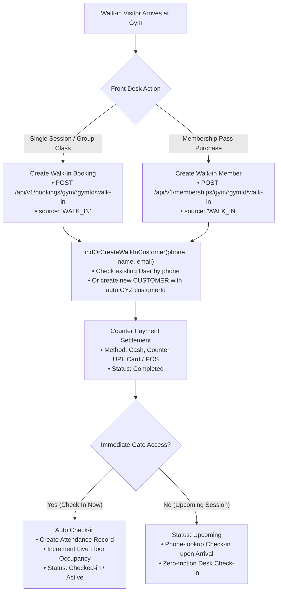
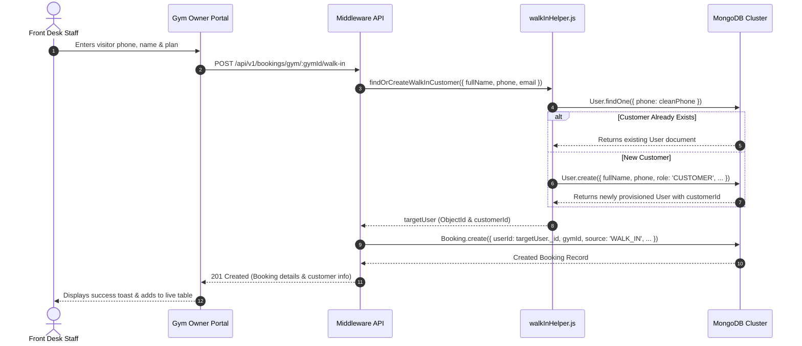
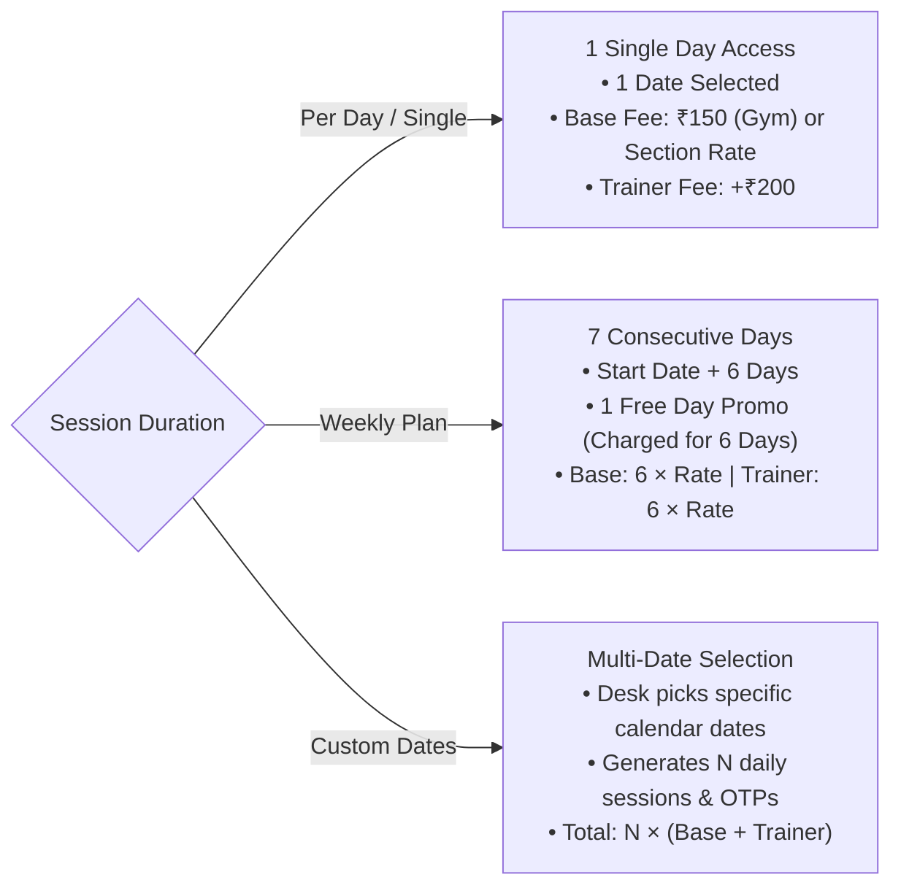

# GYMEZY Walk-in Model & Front-Desk Operations Specification

This document details the architecture, data models, customer resolution pipeline, front-desk counter payment flows, and turnstile check-in execution of the **Walk-in Operations System** across the GYMEZY platform.

---

## 1. Architectural Overview & System Purpose

The **Walk-in Model** allows gym owners, managers, and front-desk administrators to create single-session passes, group class bookings, and multi-tier memberships directly from the Gym Owner Portal for offline visitors who walk into the gym without having the GYMEZY mobile application pre-installed.



---

## 2. Source Disambiguation: APP vs. WALK_IN

Every booking and membership record on the GYMEZY platform explicitly tracks its origination source via the `source` field.

| Source | Enum Value | Initiator | Payment Channel | Initial Status | Pass Identifier Format |
|---|---|---|---|---|---|
| **Mobile App** | `'APP'` | Registered User on GYMEZY App | In-App Razorpay, Stripe, or Gym Wallet | `Confirmed` / `Active` | Sequential `BK...` or `MEM...` with Entry QR Code |
| **Front Desk** | `'WALK_IN'` | Gym Owner, Manager, or Staff Desk | Cash at Desk, Counter UPI (QR), POS Card Swipe | `Checked-in` (immediate) or `Upcoming` | Sequential `BK...` or `MEM...` with Phone Lookup |

### Source Constants (Single Source of Truth)

Defined in [`booking.model.js`](../middleware/src/models/booking.model.js) and [`membership.model.js`](../middleware/src/models/membership.model.js):

```javascript
export const BOOKING_SOURCES = ['APP', 'WALK_IN'];
export const MEMBERSHIP_SOURCES = ['APP', 'WALK_IN'];
```

---

## 3. Customer Identity Auto-Resolution Pipeline

Offline visitors often do not have an existing GYMEZY login. To maintain relational integrity and allow seamless account unification if the visitor later downloads the app:

1. Front-desk enters visitor's **Full Name**, **10-Digit Phone Number**, and optional **Email**.
2. [`walkInHelper.js`](../middleware/src/utils/walkInHelper.js) cleans and normalizes the phone number (extracting standard 10-digit format).
3. Database checks if a `User` already exists with this phone number:
   - **User Exists**: Links the walk-in booking or membership directly to the existing account `_id` and preserves their `customerId`.
   - **User Does Not Exist**: Automatically provisions a standard `CUSTOMER` record:
     - Sets `role: 'CUSTOMER'`.
     - Assigns clean phone, full name, and generated email placeholder if none provided.
     - Auto-generates standard sequential `customerId` (`GYZ0001`, `GYZ0002`, etc.) via Mongoose pre-save counter hook.
     - Sets a cryptographically strong random password for local account compatibility.
4. **App Sync**: If the customer subsequently registers on the GYMEZY mobile app using the same mobile number, their historical walk-in sessions and active memberships are instantly accessible.



---

## 4. Front-Desk Payment Settlement & Immediate Check-in

### Counter Payment Handling
- Offline visitors pay at the turnstile or front desk counter.
- Accepted payment methods: `Cash`, `Counter UPI` (gym's static QR code), `POS Card Swipe`.
- Payment status defaults to `Completed` with `paidAt: new Date()`.
- Financial amounts are credited directly to the gym's physical collections without triggering in-app gateway commissions.

### Check-in Behavior
The desk operator can select one of two entry modes:
1. **Check-in Now (`checkInNow: true`)**:
   - Booking `status` set to `Checked-in` / `Active`.
   - An `Attendance` record (`status: 'Checked-In'`) is created immediately.
   - Increases the gym's live floor occupancy counter.
2. **Upcoming Slot (`checkInNow: false`)**:
   - Booking `status` set to `Upcoming` or `Confirmed`.
   - Visitor can arrive later today or on a future date and check in by quoting their mobile number at the desk or scanner terminal.

---

## 5. Walk-in Operations in Gym Owner Portal

### 5.1 Bookings Management (`/owner/bookings`)
- **Action Button**: `+ Create Walk-in Booking` opens the walk-in modal.
- **Source Filter Tabs**: Filter by `All Sources`, `GYMEZY App`, or `Front-Desk Walk-in`.
- **Badges**:
  - `WALK-IN` in vibrant purple tag (`color="purple"`).
  - `APP` in classic blue tag (`color="blue"`).
- **Deep Linking**: Navigating to `/owner/bookings?action=walkin` automatically opens the booking creation modal.

### 5.2 Membership Management (`/owner/members`)
- **Action Button**: `+ New Walk-in Member` launches the membership registration form.
- **Tier Selection**: Monthly, Quarterly, Half-Yearly, and Annual with auto-calculated duration dates (`endDate`).
- **Source Filter Tabs**: Filter by `All Sources`, `GYMEZY App`, or `Walk-in`.
- **Badges**: Dedicated `Source` column displaying `WALK-IN` and `APP` tags.
- **Deep Linking**: Navigating to `/owner/members?action=walkin` automatically opens the member creation modal.

### 5.3 Turnstile Fast Lookup (`/owner/checkin`)
- Front-desk staff can search upcoming walk-ins by entering the visitor's 10-digit mobile number, full name, or booking ID.
- Search results display customer name, phone number, pass type, and an explicit `WALK-IN` badge.
- A single click on **"Verify & Check In"** validates access, unlocks the turnstile gate, creates the attendance record, and launches confetti confirmation.

### 5.4 Dashboard Quick Actions (`/owner/dashboard`)
- Direct shortcut cards for **"New Walk-in Booking"** and **"New Walk-in Member"** in the Quick Actions section.
- Recent Bookings and Membership Status tables render `APP` vs `WALK-IN` pills alongside each customer record.

---

## 6. API Specification & Request / Response Contracts

### 6.1 Create Walk-in Booking
- **Endpoint**: `POST /api/v1/bookings/gym/:gymId/walk-in`
- **Access**: Gym Owner, Gym Admin, Gym Manager

#### Request Payload
```json
{
  "customerName": "Ramesh Kumar",
  "phone": "9876543210",
  "email": "ramesh@example.com",
  "bookingType": "GYM_SESSION",
  "date": "2026-11-04",
  "timeSlot": "07:00 AM",
  "amount": 150,
  "paymentMethod": "Cash",
  "checkInNow": true
}
```

#### Response (201 Created)
```json
{
  "success": true,
  "message": "Walk-in booking created successfully for Ramesh Kumar.",
  "data": {
    "_id": "672879a834b9d031cba41e12",
    "bookingId": "BK00142",
    "userId": "672879a834b9d031cba41e10",
    "gymId": "67243912a7f80b2a8d132cb0",
    "bookingType": "GYM_SESSION",
    "source": "WALK_IN",
    "startDate": "2026-11-04T00:00:00.000Z",
    "timeSlot": "07:00 AM",
    "status": "Checked-in",
    "pricing": {
      "totalAmount": 150,
      "basePrice": 150,
      "taxAmount": 0
    },
    "payment": {
      "method": "Cash",
      "status": "Completed",
      "paidAt": "2026-11-04T05:58:32.120Z"
    },
    "walkInDetails": {
      "isWalkIn": true,
      "customerName": "Ramesh Kumar",
      "customerPhone": "9876543210",
      "paymentMethod": "Cash"
    }
  }
}
```

---

### 6.2 Create Walk-in Membership
- **Endpoint**: `POST /api/v1/memberships/gym/:gymId/walk-in`
- **Access**: Gym Owner, Gym Admin, Gym Manager

#### Request Payload
```json
{
  "customerName": "Priya Sharma",
  "phone": "9840123456",
  "email": "priya@example.com",
  "tier": "Quarterly",
  "amount": 4499,
  "startDate": "2026-11-04",
  "paymentMethod": "UPI"
}
```

#### Response (201 Created)
```json
{
  "success": true,
  "message": "Walk-in membership created successfully for Priya Sharma.",
  "data": {
    "_id": "67287b4134b9d031cba41e24",
    "membershipId": "MEM00088",
    "userId": "67287b4134b9d031cba41e22",
    "gymId": "67243912a7f80b2a8d132cb0",
    "membershipTier": "Quarterly",
    "source": "WALK_IN",
    "startDate": "2026-11-04T00:00:00.000Z",
    "endDate": "2027-02-04T00:00:00.000Z",
    "status": "Active",
    "pricing": {
      "totalAmount": 4499
    },
    "payment": {
      "method": "UPI",
      "status": "Completed"
    },
    "walkInDetails": {
      "isWalkIn": true,
      "customerName": "Priya Sharma",
      "customerPhone": "9840123456",
      "paymentMethod": "UPI"
    }
  }
}
```

---

### 6.3 Querying Gym Bookings & Memberships with Source Filter
- `GET /api/v1/bookings/gym/:gymId?source=ALL` (default)
- `GET /api/v1/bookings/gym/:gymId?source=APP` (returns online mobile bookings only)
- `GET /api/v1/bookings/gym/:gymId?source=WALK_IN` (returns front-desk bookings only)

Same parameters apply to memberships:
- `GET /api/v1/memberships/gym/:gymId?source=ALL|APP|WALK_IN`

---

## 7. Mongoose Schema Reference

### `Booking` Schema Fields
```javascript
source: {
  type: String,
  enum: ['APP', 'WALK_IN'],
  default: 'APP',
  index: true,
},
walkInDetails: {
  isWalkIn: { type: Boolean, default: false },
  customerName: { type: String, trim: true },
  customerPhone: { type: String, trim: true },
  customerEmail: { type: String, trim: true },
  bookedByEmployeeId: { type: mongoose.Schema.Types.ObjectId, ref: 'Employee' },
  paymentMethod: { type: String, enum: ['Cash', 'UPI', 'POS', 'Card', 'Other'], default: 'Cash' },
  customPriceOverride: { type: Boolean, default: false },
  approvedByOwnerId: { type: mongoose.Schema.Types.ObjectId, ref: 'User' },
}
```

### `Membership` Schema Fields
```javascript
source: {
  type: String,
  enum: ['APP', 'WALK_IN'],
  default: 'APP',
  index: true,
},
walkInDetails: {
  isWalkIn: { type: Boolean, default: false },
  customerName: { type: String, trim: true },
  customerPhone: { type: String, trim: true },
  customerEmail: { type: String, trim: true },
  registeredByEmployeeId: { type: mongoose.Schema.Types.ObjectId, ref: 'Employee' },
  paymentMethod: { type: String, enum: ['Cash', 'UPI', 'POS', 'Card', 'Other'], default: 'Cash' },
  customPriceOverride: { type: Boolean, default: false },
  approvedByOwnerId: { type: mongoose.Schema.Types.ObjectId, ref: 'User' },
}
```

---

## 8. Pass Types, Duration Tiers, Active Sections & Personal Trainer Selection

Front-desk operations cater to diverse visitor requirements ranging from quick one-day visits to ongoing specialty fitness classes and long-term VIP memberships with personal training.

### 8.1 Membership Plans: Annual vs. Monthly & Personal Trainer Selection

When an offline visitor opts for gym membership at the desk (`/owner/members` -> `+ New Walk-in Member`), the operator configures:

#### 1. Membership Plan Tier
| Plan Name | Internal Tier | Duration | Base Price (INR) | Inclusions & Perks |
|---|---|---|---|---|
| **Silver (1 Month)** | `Monthly` | 30 Days | ₹1,599 | Standard gym floor access, peak hour entry |
| **Gold (3 Months)** | `Quarterly` | 90 Days | ₹4,499 | Floor access, locker facility, 1 diet consultation |
| **Platinum (6 Months)** | `Half-Yearly` | 180 Days | ₹7,999 | All gym facilities, 1 free guest pass, shower/steam |
| **Annual (12 Months)** | `Annual` | 365 Days | ₹14,999 | VIP all-access pass, priority locker, sauna, events |

#### 2. Personal Trainer Selection
- The desk can choose **"No Personal Trainer (General Gym Access)"** or select an approved gym trainer from the live staff roster loaded via `GET /api/v1/employees?gymId=:gymId&role=Trainer&approvalStatus=Approved`.
- Trainer fees scale with the duration of the membership plan:
  - **1 Month**: +₹2,000
  - **3 Months**: +₹5,500
  - **6 Months**: +₹10,000
  - **12 Months (Annual)**: +₹18,000
- **Live Fee Calculation**: The UI automatically computes:
  $$\text{Total Amount} = \text{Base Plan Price} + \text{Personal Trainer Fee}$$
  *(e.g., Annual Plan ₹14,999 + Dedicated Coach ₹18,000 = ₹32,999 auto-filled in the payment box).*

---

### 8.2 Session Bookings: Per Day vs. Weekly Plan vs. Custom Dates

For visitors seeking pay-as-you-go access rather than a long-term membership (`/owner/bookings` -> `+ Create Walk-in Booking`), the desk selects from three duration tiers:



1. **Single Day (Per Day)**:
   - Grants pass for one session on the selected booking date.
   - Base fee: ₹150 for general workout, or section fee if joining a class.
2. **Weekly Pass (7 Days)**:
   - Sets `startDate` to selected date and auto-computes `endDate = startDate + 6 days`.
   - Incorporates promotional pricing: **6 days charged, 1 free day**.
3. **Custom Multi-Dates (`isCustomDates: true`)**:
   - For visitors who visit on non-consecutive days (e.g., Monday, Wednesday, Friday across multiple weeks).
   - The operator picks individual session dates using the custom date picker. Selected dates appear as removable pills with a count badge.
   - The backend stores each date in `customDates: [{ date, status: 'Upcoming', dailyOtp }]`, generating an independent 6-digit access OTP for each scheduled day.
   - Pricing multiplies the per-session fee by the exact count of dates chosen.

---

### 8.3 Selecting Activity / Ongoing Sections (Yoga, Zumba, CrossFit, Pilates)

Front-desk staff can register walk-ins for open gym floor access or assign them directly into an ongoing or upcoming group class/section:

1. **Activity Dropdown Options**:
   - `🏋️ General Gym Workout (Floor Access & Machines)`: Open floor workout (Default ₹150 / session).
   - **Active Gym Sections**: Dynamically populated from `GET /api/v1/sections?gymId=:gymId`.
     - *Example 1*: `🧘 Morning Yoga (06:00 AM - 07:00 AM) — ₹250 / session`
     - *Example 2*: `💃 Zumba Dance Fitness (07:30 AM - 08:30 AM) — ₹300 / session`
     - *Example 3*: `🏋️ CrossFit Conditioning (06:00 PM - 07:00 PM) — ₹350 / session`
2. **Automatic Field Population**:
   - When a specific section is chosen:
     - `bookingType` is set to `GROUP_CLASS`.
     - `sectionId` is linked to the booking record.
     - `timeSlot` is auto-filled to match the section's schedule (e.g. `06:00 AM - 07:00 AM`).
     - `amount` is updated to the section's defined `cost`.
     - If the section has an assigned lead trainer, that trainer is automatically linked.
3. **Personal Trainer Session Add-on**:
   - The desk can also attach a dedicated personal trainer to any session (+₹200 / session).
   - When selected, the trainer is linked via `trainerId`, ensuring the trainer's schedule and compensation ledger accurately record the walk-in client.


